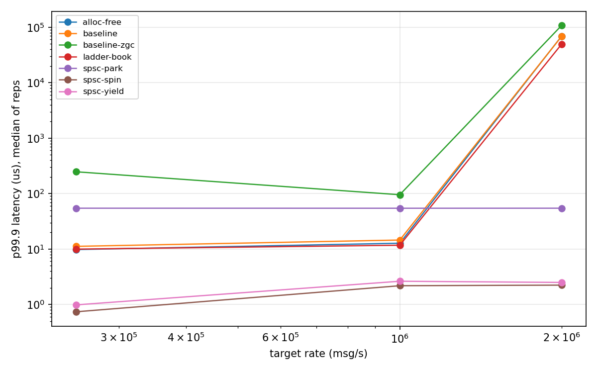
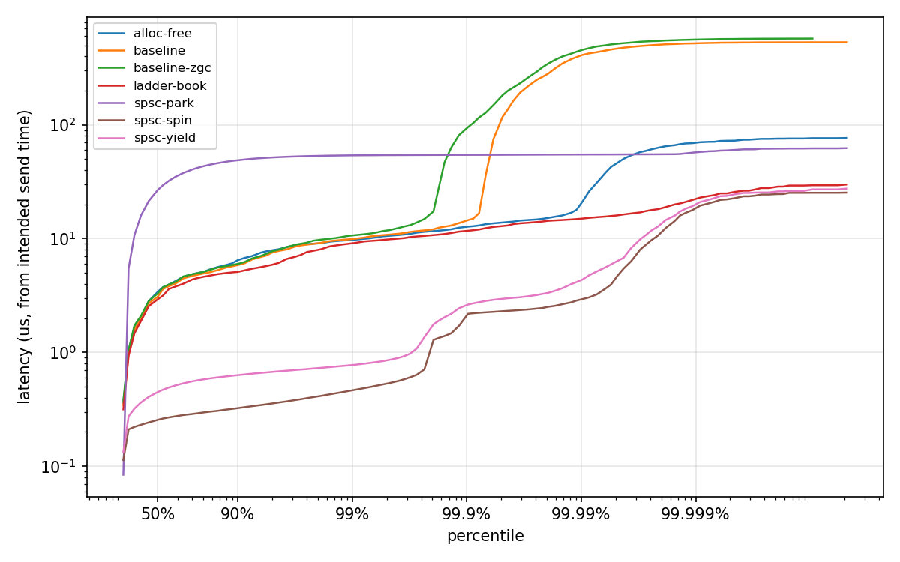

# Java Trading Engine

A single-instrument limit order book and trading strategy in Java, plus a harness for measuring its tail latency. A reader thread replays a binary market-data feed at a fixed rate, an engine thread runs the book and strategy, and each run writes latency histograms and a hash of every event the book produced.

The engine comes in several variants. Each one changes one part of the hot path (allocation, book data structure, thread handoff, wait strategy) and has to produce the same output hash as the baseline. Notes on what the experiments showed are in [docs/findings.md](docs/findings.md).

## Build and run

Requires JDK 25 and Maven 3.9.

```bash
mvn -q -B verify
java -jar engine/target/engine.jar gen --profile burst --count 2000000 --seed 1 --out feeds/burst.bin
java -jar engine/target/engine.jar --variant spsc --feed feeds/burst.bin --rate 1000000 --warmup 200000 --out run/spsc.hgrm
```

The last command prints throughput, the output hash, and p50/p99/p99.9/p99.99/max latency, and writes `run/spsc.hgrm`, `run/spsc-triggered.hgrm` and `run/spsc.meta`.

Other options: `--warmup-passes N` (default 2), `--cpus reader,engine` to pin the two threads (Linux only), `--wait spin|yield|park` for the `spsc` consumer, and `--outliers file.csv` to log individual slow messages with the engine's own processing time. `engine annotate` replays a feed and reports the book state at the logged positions.

## Variants

| `--variant` | Handoff | Decode | Book |
|---|---|---|---|
| `baseline` | `ArrayBlockingQueue` of records | new `record` per message | `TreeMap<Long, ArrayDeque<Order>>` |
| `alloc-free` | `ArrayBlockingQueue` of reused offset slots | `FrameView` flyweight over the feed buffer | `PooledOrderBook`: pooled orders, Agrona primitive maps |
| `ladder-book` | same as `alloc-free` | same as `alloc-free` | `LadderBook`: price levels indexed directly by price, orders in primitive arrays |
| `spsc` | `SlotSignalRing`, a lock-free single-producer single-consumer ring | same as `alloc-free` | `LadderBook` |

All books implement `Book` and share one set of contract tests. `PooledOrderBookTest` and `LadderBookTest` also replay generated feeds through both the new book and the `TreeMap` book and compare the event hashes.

## How latency is measured

- The feed is generated from a seed and read fully into memory before timing starts. Frames are 32 bytes, little-endian: new order, cancel, or tick (`Codec` documents the layout).
- Replay is open-loop. Message `i` is due at `start + i / rate`, and latency is measured from that due time to the moment the engine finishes the message. If the engine stalls, every message queued behind the stall records the delay. `OpenLoopTest` checks this by stalling the engine for 20 ms.
- Latency goes into two HdrHistograms: all messages, and only the ticks that made the strategy send an order.
- Before the measured run, the full feed is replayed twice with a fresh engine so JIT compilation and deoptimization happen outside the measurement. The first `--warmup` messages of the measured run are dropped as well.
- The `.meta` file records the JVM, flags, collector, host, CPU count, pinning, wait strategy, output hash, GC count and process CPU time for the run.

## Correctness

`GoldenOutputTest` replays a committed 5,000-message feed (`engine/src/test/resources/feeds/golden-burst-5k.bin`) through every variant and checks the output hash, event count and trigger count. If engine behavior changes on purpose, the constants in that test change in their own commit.

`AllocationTest` measures bytes allocated by the engine thread over 300k warm messages for the pooled and ladder paths. `scripts/epsilon_proof.sh` runs `spsc` under Epsilon GC with a 128 MB heap, where nothing is ever freed, and checks it still matches the baseline hash. `alloc-free` doesn't reliably pass the same check because `ArrayBlockingQueue` allocates a node each time the engine thread waits.

## Scripts

| Script | What it does |
|---|---|
| `scripts/sweep.sh [variant]` | one JVM per rate across a list of rates, results in `results/local/` |
| `scripts/gc_compare.sh [variant]` | same run under several collectors, interleaved |
| `scripts/profile.sh [variant]` | JFR recording and, if installed, an async-profiler pass |
| `scripts/epsilon_proof.sh` | allocation check described above |
| `scripts/plot.py <run dirs>` | percentile plot and latency-vs-throughput table from `.hgrm` files |
| `scripts/oscar.sbatch` | the measurement job for Brown's Oscar cluster |
| `scripts/oscar_profile.sbatch` | follow-up job: outlier logs, safepoints, interrupt counts, `HashMap.resize` trace |

JMH benchmarks are in `benchmarks/`: `DecodeBench` (allocation of the decode step), `HandoffBench` (cross-thread handoff cost for `ArrayBlockingQueue`, both in-house rings, Agrona `OneToOneRingBuffer` and the Disruptor), and `LayoutDump` (JOL object layouts). Run them with `java -jar benchmarks/target/benchmarks.jar <name>`.

## Results

From Oscar job 7913307: an exclusive `48core` node (2x Intel Xeon Platinum 8268, 24 cores per socket, no SMT), JDK 25.0.2, G1 with a 1 GB heap unless noted, reader and engine pinned to cores 2 and 3, JVM housekeeping on core 1. Each configuration ran 5 times at each rate, interleaved, on a 2M-message burst feed with two warmup replays and the first 200k measured messages dropped. Latency is from each message's scheduled send time to the end of processing. Values are the median across the 5 runs.

| Config | p50 @ 1M/s | p99 @ 1M/s | p99.9 @ 1M/s | max @ 1M/s | Keeps up at 2M/s |
|---|---|---|---|---|---|
| `baseline` | 3.1 µs | 10.0 µs | 14.5 µs | 513 µs | 0 of 5 runs |
| `baseline` + ZGC | 3.3 µs | 10.7 µs | 95.4 µs | 572 µs | 0 of 5 |
| `alloc-free` | 3.1 µs | 9.8 µs | 12.7 µs | 77 µs | 1 of 5 |
| `ladder-book` | 3.0 µs | 9.4 µs | 11.7 µs | 38 µs | 1 of 5 |
| `spsc`, spin | 0.3 µs | 0.5 µs | 2.2 µs | 25 µs | 5 of 5 |
| `spsc`, yield | 0.4 µs | 0.8 µs | 2.6 µs | 28 µs | 5 of 5 |
| `spsc`, park | 26.8 µs | 53.9 µs | 54.4 µs | 62 µs | 5 of 5 |

"Keeps up" means the run delivered at least 99% of the target rate. When a run falls behind, the queue grows and latency goes to tens of milliseconds. The full table for all three rates (250k, 1M, 2M msg/s) with the p99.9 range across runs is in [`results/oscar/7913307/summary.md`](results/oscar/7913307/summary.md).





The percentile plot uses the run with the median p99.9 for each configuration. Two features of it are traced in [docs/findings.md](docs/findings.md): `baseline`'s ~500 µs maximum is a `java.util.HashMap` resize in the order book's id index, and the step in the `spsc` curves near p99.8 is the kernel's 1,000 Hz timer interrupt on the reader and engine cores. The follow-up job is `scripts/oscar_profile.sbatch` and its output is in `results/oscar/7954130/`.

The job script is `scripts/oscar.sbatch`; `.meta` files next to each histogram record the exact JVM flags, pinning and output hash. On Oscar there is no control over `isolcpus`, `nohz_full`, the frequency governor or turbo. `taskset` keeps the JVM on cores 1 to 3, but only the reader and engine threads are pinned to a single core each, so GC and JIT threads can still run on cores 2 and 3. Development runs on macOS aren't comparable to these: macOS has no thread pinning and moves threads between core types.

The Dockerfile builds and runs the engine anywhere (`docker build -t trading-engine . && docker run --rm trading-engine`). It hasn't been built yet, and container timings aren't used.

## Limitations

- One instrument and one toy strategy. The book handles price-time priority, partial fills and cancels, nothing else.
- The feed carries no timestamps. The `burst` profile changes message content (bigger price moves, more orders and cancels), not arrival timing.
- The reader thread busy-spins until each message is due, so process CPU time is at least one core regardless of wait strategy.
- Thread pinning uses OpenHFT affinity and does nothing on macOS. On Linux, each run's `.meta` file shows the CPU each thread actually ran on.
- The hyperthread-sibling configuration in `scripts/oscar.sbatch` needs a node with SMT; the `48core` nodes have none, so it hasn't run.
